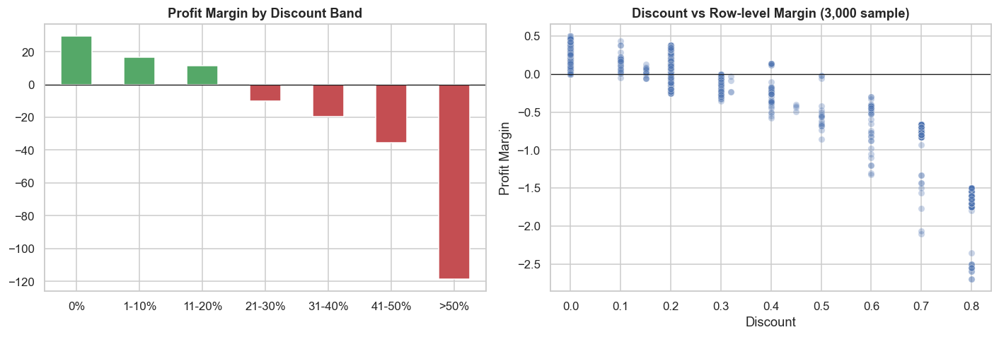
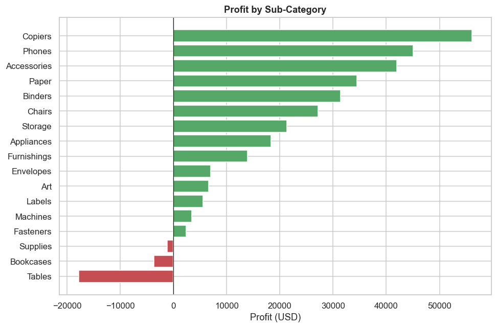

# Superstore Profitability Analysis

> **Why does profit lag behind sales, and where should the business act first?**
> An end-to-end exploratory analysis of 10,194 retail order lines (2023 to 2026) with Python.

  

## Business problem
Sales grow every year, but profit does not grow at the same rate. Leadership wants to know **where margin is being lost** and **what to change first**.

## Headline numbers
| Total sales | Total profit | Profit margin | Orders | Customers |
|:-:|:-:|:-:|:-:|:-:|
| $2.33M | $292K | 12.6% | 5,111 | 804 |

## Key findings
| # | Finding | Evidence |
|:-:|---------|----------|
| 1 | **Discounts above 20% always lose money** | Margin is 29.6% with no discount and negative from 21% upward. Those lines lose about $136K combined. |
| 2 | **Furniture barely breaks even** | 2.6% margin vs about 17% for Technology and Office Supplies. Tables (-$17.8K) and Bookcases (-$3.6K) lose money. |
| 3 | **Central region underperforms** | 7.9% margin vs 15.0% in the West, with a 24% average discount vs 11%. |
| 4 | **The top customer by sales is unprofitable** | 159 of 804 customers (20%) cost the business money. |
| 5 | **Shipping mode is not a profit driver** | Margins stay between 12.2% and 13.9% across all modes. |





## Recommendations
1. **Cap discounts at 20%** and require approval above that. Bringing over-discounted lines to break-even would raise total profit by about 47%.
2. **Reprice Tables and Bookcases** and review supplier cost.
3. **Align Central's discount policy** with the West and East.
4. **Report customer profit, not only sales,** in account reviews.
5. **Plan for the Sep, Nov and Dec peak** (43% of sales) without deep discounting.

## Approach
1. Define the business problem and five guiding questions
2. Validate the data (duplicates, missing values, impossible dates and discounts)
3. Engineer features: ship days, year, month, profit margin, discount bands
4. Analyse trend, category, region, discount, customers (including RFM) and shipping
5. Turn each finding into a recommendation

## Repository structure
```
superstore-analysis/
├── superstore_analysis.ipynb   # full analysis with charts and written insights
├── data/
│   ├── 123.xls                 # raw data
│   └── superstore_processed.csv # raw data + engineered columns, ready for Tableau / Power BI
├── images/                     # exported charts
├── requirements.txt
└── README.md
```

## How to run
```bash
git clone https://github.com/<your-username>/superstore-analysis.git
cd superstore-analysis
pip install -r requirements.txt
jupyter notebook superstore_analysis.ipynb
```

## Limitations
- No product cost, marketing cost or returns in the data, so profit is taken as reported.
- US only, with no customer demographics beyond segment.
- Findings show association, not proof of cause.

## Next steps
- Interactive dashboard (Tableau Public or Power BI) built from `data/superstore_processed.csv`
- Simulate a 20% discount cap to estimate its effect on sales volume as well as profit

## Tools
Python, pandas, NumPy, matplotlib, seaborn, Jupyter
# Store-Analysis
